# Studio Architecture: HLD and LLD

> Design 1 of 3 · Status: **Proposed** · 2026-10-30
> Builds on [`ARCHITECTURE.md`](../../ARCHITECTURE.md), which stays the source of truth for *what* to build.
> Items tagged **H-xx** (new capabilities) and **CL-xx** (clarifications) are proposals. They take effect only after the author accepts them in `docs/decisions.md` (register: [README](README.md#proposed-deltas)).
> Facts about the Claude CLI were checked against Claude Code **2.1.314** (`claude --help` and the CLI bundle) on 2026-10-30. Re-verify at build time (ARCHITECTURE §18).

## Contents

**Part I: High-level design (HLD)**
1. [Vision: two front doors, one core](#1-vision-two-front-doors-one-core)
2. [Architectural drivers](#2-architectural-drivers)
3. [Collaboration domain model](#3-collaboration-domain-model)
4. [System context](#4-system-context)
5. [Containers and processes](#5-containers-and-processes)
6. [Core components and layering](#6-core-components-and-layering)
7. [Key runtime scenarios](#7-key-runtime-scenarios)
8. [Trust and security architecture](#8-trust-and-security-architecture)
9. [Deployment view](#9-deployment-view)
10. [Technology decisions](#10-technology-decisions)
11. [Quality attributes and mechanisms](#11-quality-attributes-and-mechanisms)
12. [Proposed deltas and clarifications](#12-proposed-deltas-and-clarifications)
13. [Risks and open questions](#13-risks-and-open-questions)

**Part II: Low-level design (LLD)**
14. [Crate map and dependency rules](#14-crate-map-and-dependency-rules)
15. [Runtime and concurrency model](#15-runtime-and-concurrency-model)
16. [Protocol](#16-protocol)
17. [Agent layer](#17-agent-layer-studio-agents)
18. [Agent Gateway](#18-agent-gateway-studio-gateway-h-02)
19. [Collaboration hub](#19-collaboration-hub-studio-collab)
20. [Change Ledger](#20-change-ledger)
21. [Terminal service](#21-terminal-service-studio-pty)
22. [File, git, search, LSP, build, learn, plugins](#22-file-git-search-lsp-build-learn-plugins)
23. [Policy service](#23-policy-service-studio-policy)
24. [Data model (DDL)](#24-data-model-ddl)
25. [UI client architecture](#25-ui-client-architecture)
26. [Errors, logging, diagnostics](#26-errors-logging-diagnostics)
27. [Testing strategy](#27-testing-strategy)
28. [Traceability](#28-traceability)

---

# Part I: High-level design

## 1. Vision: two front doors, one core

Today's IDEs have one front door: a GUI built for a person. Agents come in through the back. They read and write files and run shell commands, and the IDE finds out what happened afterwards, if at all.

Studio has **two front doors into one core**:

| Door | Who | How they get in |
|---|---|---|
| **Human door** | Jay | Native macOS window (Tauri host + web UI) speaking the typed protocol (ARCHITECTURE §7) |
| **Agent door** | Agentic CLIs (Claude CLI first) | Launched or detected by Studio, wired back through lifecycle **hooks**, **structured event streams**, and the **Agent Gateway**, which exposes Studio capabilities (diagnostics, symbols, tests, the ledger, asking the human) as MCP tools |

Both doors produce the same internal `Command` values, pass the same policy checks, and land in the same Change Ledger. Three product properties follow:

1. **Every change has an author.** Human, agent session (and turn and tool call), Studio automation, or external, down to individual lines.
2. **Every agent action has a gate.** Trust profile, policy, approval routing, worktree isolation, and the review inbox.
3. **Everyone sees the same workspace.** Presence, the attention queue, and shared task state let one human and several agents work on a project without stepping on each other.

Scope stays as ARCHITECTURE §1 defines it: **one human, many agents**. Multi-human collaboration remains a non-goal. The actor model leaves room for it at almost no cost.

## 2. Architectural drivers

| Driver | Source | What it forces in the design |
|---|---|---|
| Attribution is exact | G16 (P0) | Shadow-repo snapshots, pre/post checkpoints around every agent tool call, line provenance |
| Agents are untrusted | G2 (P0) | Worktree isolation by default, review inbox, policy on every action, approvals routed to the human |
| Fully local | G1 (P0) | No TCP listener. UI↔core in-process; helpers over a Unix domain socket; no telemetry |
| Sessions outlive the UI | G3 (P0) | Sessions, scrollback, ledger, attention queue owned by the core. The UI is a view that can re-attach |
| Throughput under floods | G7 (P0) | Binary channels, 8–16 ms batching, credit-based flow control, bounded queues everywhere |
| Agents use the IDE, not only the disk | H-02 (proposed P1) | Agent Gateway (MCP) over stdio→UDS with per-session capability envelopes |
| Language-agnostic | G5 (P0) | LSP, spawned CLIs, declarative adapters, problem normalizers |
| Swappable host | ARCHITECTURE §4 note | Core is a headless library behind one protocol; the Tauri host holds glue only |
| Small footprint | G11 (P1) | Rust core, system WebView, lazy services, virtualized views, bounded buffers |

## 3. Collaboration domain model

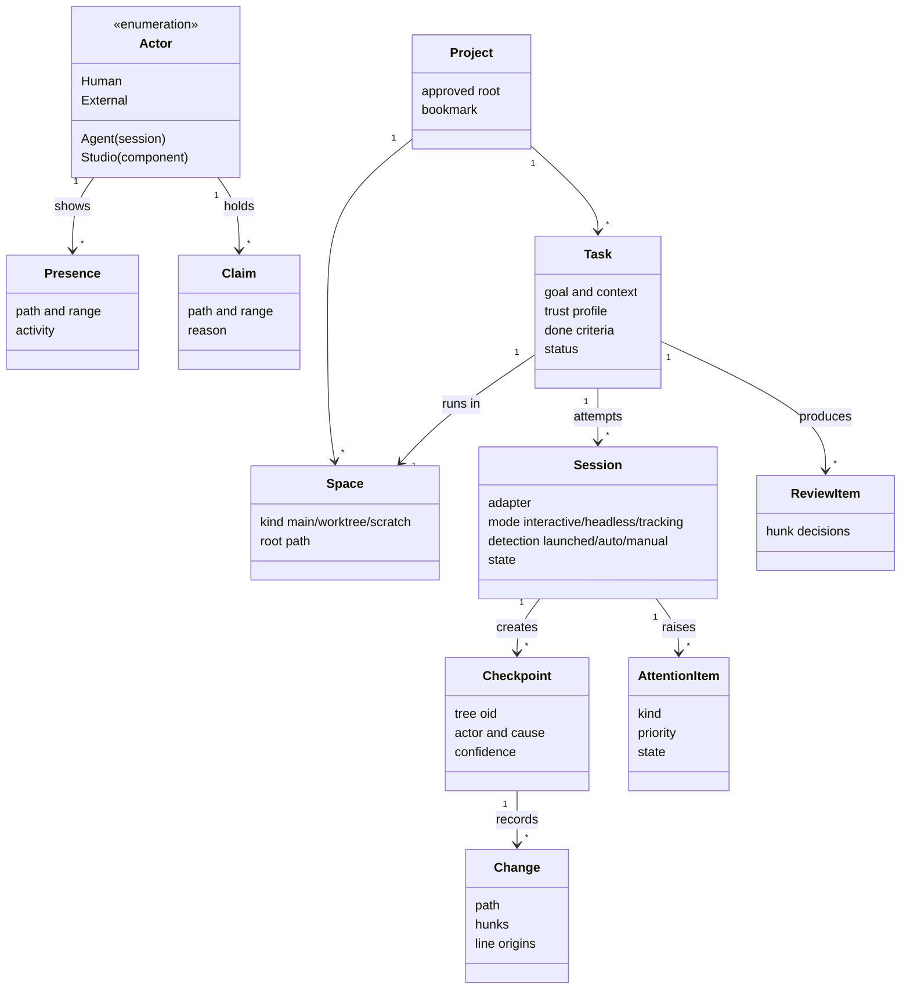

| Concept | Definition | Lifetime | Stored in |
|---|---|---|---|
| **Actor** | Who acts: `Human`, `Agent(session)`, `Studio(component)`, `External`. A value type, not a table | permanent | referenced by every record |
| **Project** | An approved root (security-scoped bookmark) | until removed | `projects` |
| **Space** | Where work happens: the `main` tree, a task `worktree`, or a `scratch` copy | per task | `agent_tasks`, `agent_sessions.space` |
| **Task** | Delegated work: goal, context, adapter, space, trust profile, done criteria, budget | until archived | `agent_tasks` |
| **Session** | One run of an agent CLI: interactive, headless, or tracking a CLI the user started | process lifetime + history | `agent_sessions` |
| **Turn / tool call** | One prompt→response cycle, and one tool invocation inside it | — | `agent_events` |
| **Checkpoint** | Snapshot tree + actor + cause + confidence | retention window | `checkpoints` + shadow repo |
| **Change / provenance** | Per-file hunks and per-line origin | retention window | `file_changes`, `line_provenance` |
| **Review item** | Hunk-level accept/reject for a worktree task | until resolved | `review_items`, `hunk_review` |
| **Attention item** | Anything that needs the human: approval, question, review ready, failure, contested file, budget | until resolved or expired | `attention_items` (H-06) |
| **Presence** | What an actor is looking at or touching right now | seconds | memory only |
| **Claim** | Soft intent-to-edit on a file or range | minutes | memory only |

**The collaboration loop**, which the whole product serves:

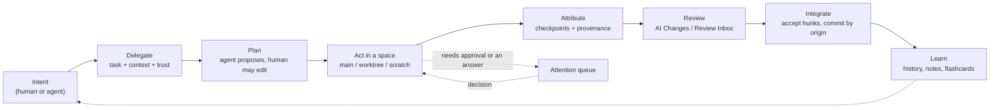

## 4. System context

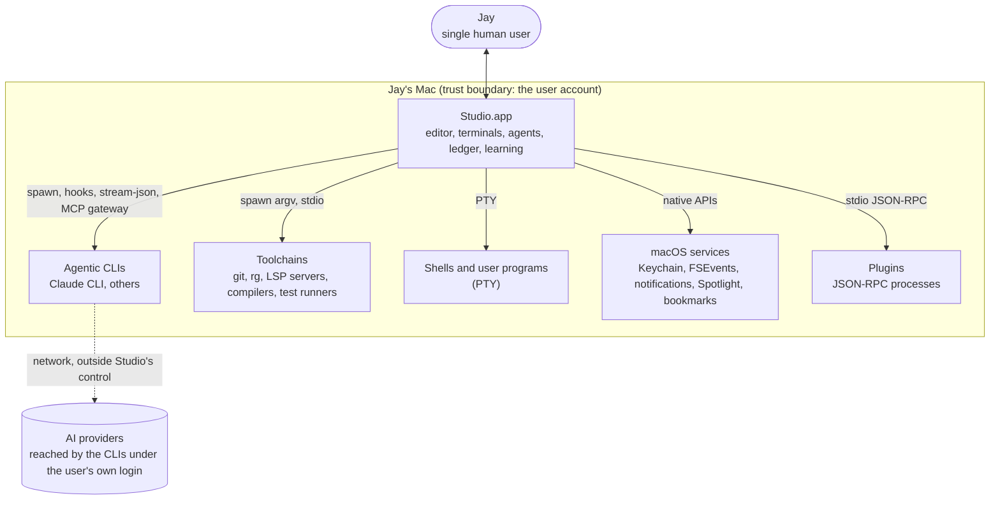

Studio itself makes **no network calls** (G1). The CLIs' own network traffic belongs to them; Studio neither proxies nor inspects it.

## 5. Containers and processes

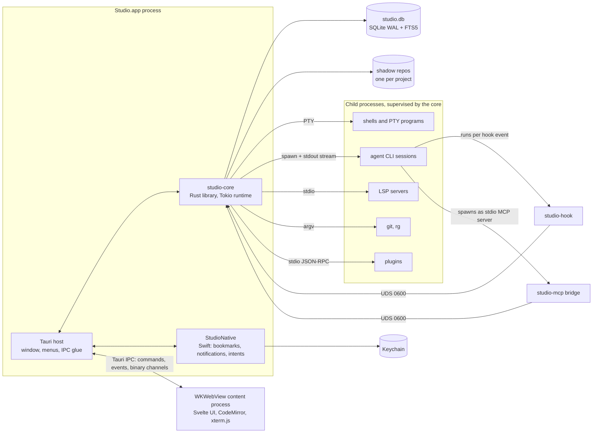

| Channel | Endpoints | Format | Purpose |
|---|---|---|---|
| Tauri commands | UI → host → core | JSON envelope | typed request/response |
| Tauri event channel | core → UI | JSON event batches every 16 ms | pub/sub with coalescing |
| Tauri binary channels | core → UI | `[u32 stream][u32 seq][bytes]` | PTY and agent streams |
| **Core socket** | `studio-hook`, `studio-mcp` → core | length-prefixed JSON (hooks), MCP JSON-RPC (gateway) | helpers started by agent CLIs reach the core without TCP |
| stdio | core ↔ LSP servers, plugins, headless agents | LSP framing, JSON-RPC, stream-json | standard for each tool |
| PTY | core ↔ shells and interactive CLIs | bytes | real terminals |

**Core socket:** `$HOME/Library/Application Support/Studio/run/core.sock`. Directory mode 0700, socket mode 0600. The peer UID is checked with `getpeereid`, and each connection authenticates with a per-session token. Darwin limits `sun_path` to 104 bytes; if the home path is too long, fall back to `$TMPDIR/studio-<uid>/core.sock`.

## 6. Core components and layering

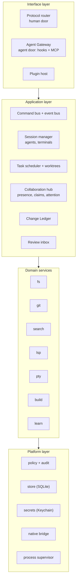

Rules:
1. **Calls go down, events go up.** No service calls a layer above it.
2. **Policy runs where the actor is known** (router or gateway) and again at the service boundary for path and spawn checks. The second check is cheap and catches wiring bugs.
3. **Only `studio-core` wires services together.** Services depend on traits, never on each other's concrete types.
4. **Both doors produce the same `Command`.** An agent calling `studio_run` and Jay pressing Run take the same code path with a different `Actor`.

## 7. Key runtime scenarios

### S1. Delegated headless task (default isolation: worktree)

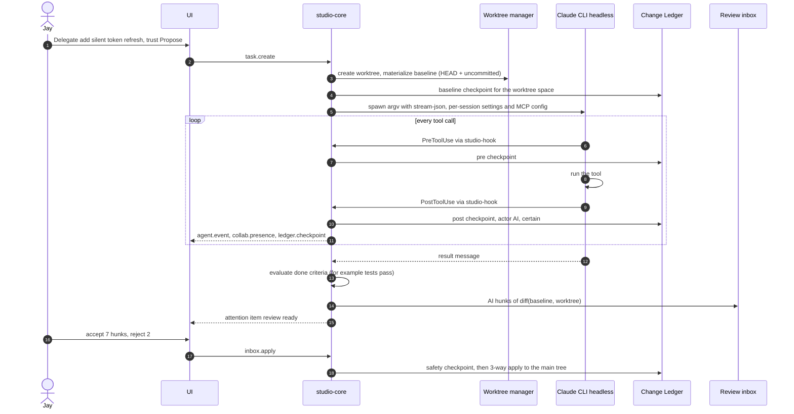

### S2. CLI started by hand in a terminal tab

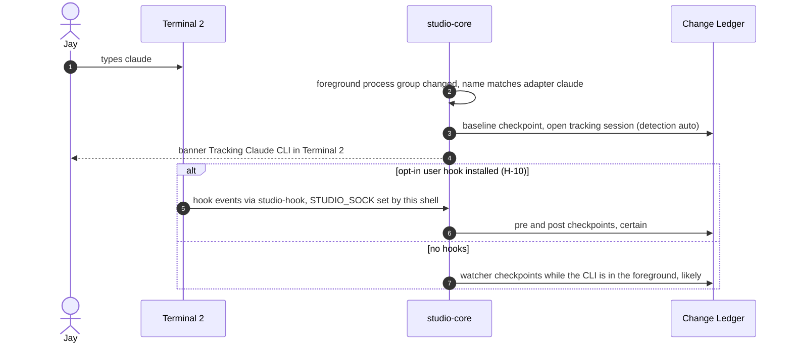

### S3. Agent uses the IDE through the Gateway

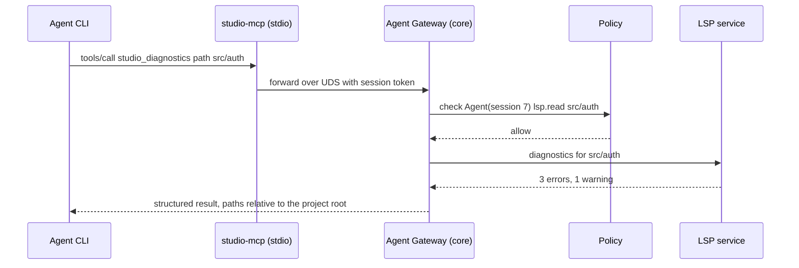

### S4. Approval routing for a headless agent

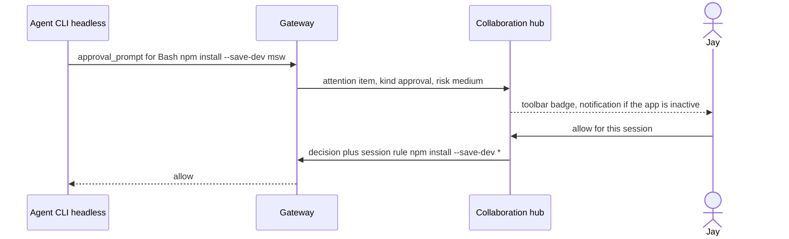

### S5. Contested edit and S6. UI reload

| Scenario | Flow |
|---|---|
| **S5 Contested edit** | An in-place agent edits `a.ts` while Jay has unsaved changes in it. The ledger records the agent's post checkpoint; the collaboration hub sees Jay's dirty-buffer claim and raises `Contested`. The editor shows a banner. On save, Studio runs a 3-way merge (base = buffer's base version, ours = buffer, theirs = disk) instead of overwriting. Conflicts open the merge view. |
| **S6 UI reload** | The WebView reloads or the window closes. Sessions, PTYs, the ledger, and attention items keep running in the core. On `app.hello`, the UI receives a session snapshot, re-attaches binary channels, and the PTY service replays scrollback (§21.3). Nothing is lost (acceptance scenario 6). |

## 8. Trust and security architecture

| Zone | Members | Trusted for | Not trusted for |
|---|---|---|---|
| **Core** | studio-core, Tauri host, StudioNative | policy decisions, ledger, audit | — |
| **Renderer** | WebView UI | showing state, issuing typed commands | anything outside the typed protocol; paths are re-validated in the core |
| **Actors** | agent CLIs, plugins | proposing changes, calling gateway tools inside their envelope | writing the main tree unreviewed (unless `in_place` is chosen), reading outside roots, approving their own actions |
| **Helpers** | `studio-hook`, `studio-mcp` | relaying events for one session | anything beyond their session token's scope |
| **Data** | file contents, agent output, tool results, web content | being shown and stored | being treated as instructions to Studio |

**Layered controls**
1. Approved roots and path canonicalization (§23).
2. Spawn allowlist; argv arrays only.
3. **Trust profiles** per session (H-03), mapped to CLI flags, hook decisions, and gateway capabilities.
4. Isolation: worktree by default for headless tasks; `in_place` only by explicit per-task choice; Autopilot never in place.
5. Review inbox: no worktree change reaches the main tree without acceptance.
6. Approval routing: risky actions become attention items; Touch ID for high risk (P2).
7. Append-only, hash-chained audit log (CL-05).
8. Secrets in Keychain only; redaction in logs, transcripts, and gateway results.
9. No TCP anywhere. The core socket is UDS 0600 + peer UID + session token.

**An honest limit.** The core socket and tokens prevent cross-talk and accidental misuse between cooperating processes. They are **not** a boundary against code running as the same macOS user, which can already read the user's files (and on macOS can read other same-user processes' environment). The real containment for agent work is worktree isolation, the review inbox, and the CLI's own permission system configured from the trust profile.

**Trust profiles (H-03)**

| Profile | File edits | Shell | Space | Asks Jay about | Default for |
|---|---|---|---|---|---|
| **Observe** | none | read-only allowlist | any | nothing (cannot act) | "Explain this", tutor mode |
| **Propose** | yes | build/test allowlist | worktree or scratch | anything off-allowlist, network-touching commands | headless tasks |
| **Pair** | yes | allowlist | main tree, tracked | edits to files Jay has open and unsaved, off-allowlist commands | interactive sessions started from Studio |
| **Autopilot** | yes | all except denylist | worktree only (enforced) | denylisted commands only | opt-in per task |

Each adapter maps profiles to its CLI's flags (§17.1). Studio's PreToolUse hook enforces the denylist and claims as a second layer regardless of the CLI's settings.

## 9. Deployment view

```
Studio.app/Contents/
  MacOS/studio              Tauri host + studio-core (one binary)
  MacOS/studio-hook         hook relay (small, no runtime deps)
  MacOS/studio-mcp          MCP stdio bridge (small, no runtime deps)
  MacOS/rg                  bundled ripgrep sidecar
  Resources/shell-integration/{zsh,bash,fish}/
  Resources/adapters/*.toml
  Frameworks/StudioNative.framework

~/Library/Application Support/Studio/
  studio.db (+ -wal, -shm)
  shadow/<project-id>.git
  worktrees/<project-id>/<task-id>/
  sessions/<session-id>/settings.json, mcp.json      per-session CLI overrides, 0600
  run/core.sock
~/Library/Logs/Studio/studio.log                     rotating, redacted
~/Library/Caches/Studio/                             rebuildable caches
Keychain                                             secrets
<user-chosen folder>/learning/                       learning content (user-owned, portable)
```

First run detects prerequisites and gives install hints: git (Xcode Command Line Tools), agent CLIs (`claude --version`), LSP servers per language, shells.

## 10. Technology decisions

| # | Decision | Choice | Main alternative | Why | Revisit if |
|---|---|---|---|---|---|
| D1 | Host | Tauri 2 (WKWebView) | native AppKit/SwiftUI | keeps CodeMirror and xterm.js, low memory; the core stays headless so the host can be swapped | web chrome cannot reach the Apple feel after M5 (§19 Q2) |
| D2 | Core placement | Rust + Tokio library inside the app process | separate launchd daemon | no extra IPC hop; sessions survive window close and UI reload | sessions must survive app quit or crash: move the core behind the same protocol into a launchd agent (CL-06) |
| D3 | UI framework | Svelte 5 + TypeScript + Vite | React | small runtime, fine-grained reactivity for high-frequency updates | — |
| D4 | Protocol codegen | `specta` → TypeScript | `ts-rs` | good support for tagged enums; verify before adopting | maintenance status changes |
| D5 | Attribution store | shadow git repo + SQLite metadata | custom content store | git gives dedup, trees, diff, and `merge-file`; the user's repo is untouched | checkpoint benchmark misses 100 ms even with gix |
| D6 | Agent integration | declarative adapters + hooks + stream-json | ACP only | the Claude CLI exposes hooks and stream-json today; evaluate ACP per CLI (A03) | most target CLIs converge on ACP |
| D7 | Agent Gateway | MCP server in the core, `studio-mcp` stdio bridge, `rmcp` crate (verify) | custom tools per CLI | most agentic CLIs support MCP; a stdio bridge avoids TCP | — |
| D8 | Helper IPC | UDS + length-prefixed JSON | XPC | portable, testable on Linux CI, no Swift glue needed | — |
| D9 | Docking | `dockview-core` (verify) | hand-written | reuse-first: ARCHITECTURE §2.2 bans hand-written docking | — |
| D10 | Terminal replay | raw-byte ring buffer with reset-safe replay | headless VT model in the core | far less memory; xterm.js re-parses quickly | replay artifacts in full-screen apps |
| D11 | Storage | SQLite WAL with one writer actor | sled, redb | FTS5, backup API, maturity | — |

## 11. Quality attributes and mechanisms

| Attribute | Target | Mechanisms | Verified by |
|---|---|---|---|
| Cold start | < 700 ms | lazy service start, DB open + migrations only, shell UI first, panels lazy | startup benchmark (T81) |
| Idle memory | < 250 MB | system WebView, no index until needed, bounded scrollback, LSP servers spawned on first file of a language | memory sampler |
| Terminal throughput | ≥ 50 MB/s, no frame drops | 8–16 ms batching, 64 KB frames, credit flow control, WebGL renderer | PTY benchmark (T23, T24) |
| Keystroke latency | < 16 ms | editor works locally first; saves are async; no synchronous IPC on keystrokes | input-latency harness |
| Checkpoint | < 100 ms typical | dirty-path sets, persistent shadow index with cache-tree, known target paths for edit tools | ledger benchmark (T30) |
| AI Changes opens | < 300 ms | provenance computed at each checkpoint; diffs cached by (oid, oid) | UI benchmark |
| Search first results | < 50 ms | in-memory `nucleo` file index, streamed ripgrep | search benchmark |
| Durability | sessions survive UI reload | core-owned sessions, UI re-attach and replay | integration test, scenario 6 |
| Crash containment | a plugin, LSP, or agent crash never takes down the core | supervisor with backoff, panic isolation at actor boundaries | fault-injection tests |

## 12. Proposed deltas and clarifications

New capabilities (accept or reject each; see [README](README.md#proposed-deltas)):

| ID | Proposal | Proposed priority | Why |
|---|---|---|---|
| H-01 | **Actor model** as one type (`Human`, `Agent(session)`, `Studio(component)`, `External`) used by policy, ledger, presence, audit | P0 (formalizes the §8A.4 actor tags) | one identity everywhere |
| H-02 | **Agent Gateway**: MCP server for studio-launched agent sessions over stdio→UDS | P1 | agents use diagnostics, symbols, tests, and the ledger instead of guessing |
| H-03 | **Trust profiles** (Observe, Propose, Pair, Autopilot), mapped per adapter | P0 for safe defaults (G2); profile UI P1 | one place to reason about agent permissions |
| H-04 | **Approval routing** through the CLI's permission-prompt tool or `PermissionRequest` hook into the attention queue | P1 (extends A09) | headless agents can ask without a terminal |
| H-05 | **Presence**: agent focus (file, range, activity) from tool events, shown in editor, tree, and tabs | P1 | Jay sees where agents are working |
| H-06 | **Attention queue** ("Needs you"): one persisted queue for approvals, questions, reviews, failures, contested files | P1 | interruptions are triaged, not scattered |
| H-07 | **Ask-human tool**: an agent asks a question with options; the answer returns as the tool result | P1 | fewer wrong guesses in long tasks |
| H-08 | **Soft claims**: Jay's unsaved buffers and in-place agent edits are visible to both sides; the hook asks before an agent edits a file Jay is editing | P2 | prevent contested edits rather than only detect them |
| H-09 | **Plan view**: map the agent's todo/plan events (for example the Claude CLI's TodoWrite tool) into the task card | P1 | progress is legible |
| H-10 | **Opt-in precise tracking** for hand-started CLIs: a hook Jay installs once that does nothing unless `STUDIO_SOCK` is set | P1 | Certain attribution for manual sessions without silently rewriting config |
| H-11 | **`studio task submit`** CLI over the core socket | P2 | scripting, and dogfooding the build workflow |
| H-12 | **Playbooks**: multi-step agent pipelines (implement → test → review) | P3 | keep an extension point only |
| H-13 | **Mission Control**: one view of all sessions and tasks with state, current step, counts, actions | P1 | the multi-agent overview the §16 layout lacks |
| G17 | New goal: **agents are first-class users of the studio** | P1 | groups H-02, H-04, H-05, H-06, H-07 |

Clarifications found while reviewing ARCHITECTURE.md:

| ID | Topic | Proposed reading |
|---|---|---|
| CL-01 | §8A.3 says large files are "tracked by hash only" yet "restorable" | Binaries ≤ 50 MB are stored as blobs (restorable, not line-diffed). Files > 50 MB are tracked by size + SHA-256 only and are **not** restorable; the UI says so. |
| CL-02 | Worktree base when Jay has uncommitted changes | Base a task's worktree on the **session baseline** (HEAD + uncommitted + untracked), materialized as files without committing, so the agent sees what Jay sees. The inbox diffs against that baseline. |
| CL-03 | Hook failure mode | Attribution hooks **fail open** (the agent continues; the gap is marked lower confidence). Approval routing for studio-launched headless sessions **fails closed** (deny). |
| CL-04 | Jay saves during an agent tool call | Studio-editor saves are bracketed by their own snapshots, so the AI call's diff excludes the save exactly. |
| CL-05 | Audit integrity | Make the audit log hash-chained so tampering is evident. |
| CL-06 | G3 versus quitting the app | Sessions survive window close and UI reload; they end when the app quits (D2). |
| CL-07 | `agent_events` keyed by task (§13) | Key events by **session**. Interactive and tracking sessions have no task. |

## 13. Risks and open questions

| Risk | Impact | Mitigation |
|---|---|---|
| Claude CLI flags or hook formats change between versions | attribution or approvals break | adapter declares `min_version` and tested versions; golden tests on recorded stream-json; degrade to Likely with a visible banner |
| FSEvents coalescing or latency hides fast edits | wrong attribution | explicit snapshots of known target paths; quiescence window for shell calls; overflow triggers a rescan |
| Shadow repo growth | disk use | commit chains per session, retention + gc, size caps, CL-01 binary policy |
| Web-rendered chrome versus Apple feel | P1 look and feel | native window, menus, and vibrancy; reassess at M5 (D1) |
| MCP support differs across CLIs | Gateway reach | Gateway is optional per adapter; hooks and the ledger still work without it |
| Approval fatigue | Jay rubber-stamps | trust profiles, session rules, risk scoring, batching of similar approvals |
| Same-user processes can spoof helpers | attribution integrity | documented limit (§8); peer UID + token; ledger cross-checks hook events with the watcher |

Open questions (in addition to ARCHITECTURE §19): accept which H-items; default trust profile for headless tasks (Propose recommended); retention defaults; whether agents may ever see Jay's editor focus (proposed: off by default, per-project opt-in).

---

# Part II: Low-level design

## 14. Crate map and dependency rules

```
crates/
  studio-protocol   types only: commands, events, frames, errors. No I/O
  studio-store      SQLite schema, migrations, writer actor, typed repositories
  studio-policy     decisions, canonicalization, spawn allowlist, trust profiles, audit
  studio-fs         approved-root file ops, watcher, ignore rules, bookmarks (native module)
  studio-git        gix reads, git CLI writes, worktrees, shadow-repo plumbing
  studio-search     nucleo file index, ripgrep streaming, FTS queries
  studio-lsp        server registry, lifecycle, request routing
  studio-pty        PTY sessions, batching, flow control, scrollback, OSC 133, foreground process
  studio-agents     adapters, sessions, tasks, worktree lifecycle, ledger, inbox, history, hook semantics
  studio-gateway    NEW (H-02): core socket server, session auth, MCP server, hook endpoint routing
  studio-collab     NEW (H-05/06/08): presence, claims, attention queue
  studio-build      run configs, runner, problems, test tree, dev servers
  studio-learn      paths, lessons, exercises, flashcards (FSRS)
  studio-plugins    plugin host
  studio-core       wiring, supervisor, command bus, event bus, protocol router
tools/
  hook-helper/      binary studio-hook
  studio-mcp/       binary studio-mcp
app/src-tauri/      host glue only
```

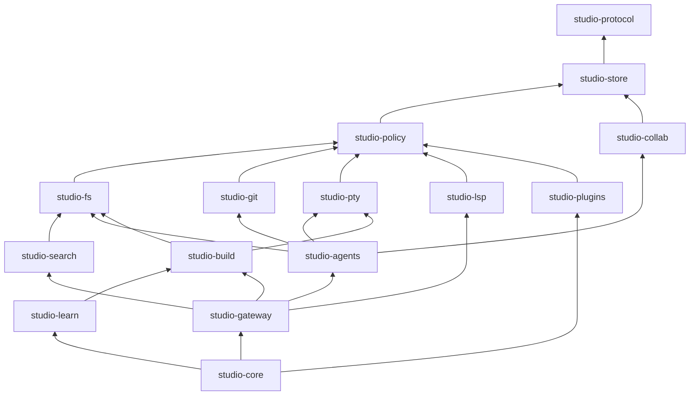

Rules:
- No cycles (Cargo enforces this).
- Each service exposes `trait XService` plus `XHandle`, a cheap-to-clone wrapper around an mpsc sender. Actor structs stay private.
- Only `studio-core` constructs handles and injects them.
- `studio-protocol` depends on `serde` and `specta` only.
- `#![forbid(unsafe_code)]` everywhere except `studio-pty` (fd and process-group calls) and `studio-fs::native` (objc2). Each keeps `unsafe` in one small, reviewed module.

## 15. Runtime and concurrency model

- **One Tokio multi-thread runtime** owned by the core (worker threads = min(4, cores)). The `spawn_blocking` pool (cap 16) handles gix walks, hashing, and other blocking work.
- **Actor per stateful service.** Each actor owns its state and receives an `enum Msg` on a bounded mpsc channel (capacity 256), replying through `oneshot`. No `Arc<Mutex<_>>` on hot paths.
- **Event bus:** `tokio::sync::broadcast` (capacity 4096) for control events. A subscriber that lags gets `Lagged` and asks for a fresh snapshot (`*.snapshot` commands). Binary streams never go through the broadcast bus.
- **Database:** one dedicated writer thread that batches writes into a transaction every 10 ms or 500 operations. Readers use a small pool of read-only connections (WAL permits concurrent reads).
- **Cancellation:** a `CancellationToken` tree: app → project → session/task → operation. Dropping a handle cancels its subtree.
- **Supervision:** a `Supervisor` restarts actors with exponential backoff (100 ms → 30 s). After 5 restarts in 60 s it marks the service degraded and raises an attention item. Actor panics surface through the `JoinHandle` and are logged with context.
- **PTY reads** use one blocking thread per PTY (portable-pty readers are blocking). This is cheap at the expected terminal counts.

**Backpressure inventory**

| Stream | Producer | Bound | When full |
|---|---|---|---|
| PTY output → UI | PTY reader | in-flight credit: 2 MB high, 512 KB low | stop reading the PTY; the kernel buffer fills and the child blocks |
| PTY output, no UI attached | PTY reader | ring buffer: 50k lines or 8 MB | drop oldest (children never block while detached) |
| Agent stdout | CLI | parser channel: 1024 messages | stop reading stdout; the CLI blocks on write |
| Agent events → UI | parser | event bus: 4096 | subscriber resyncs from a snapshot |
| Filesystem events | notify | dirty-path set (deduplicated) | overflow triggers a subtree rescan |
| Database writes | services | queue: 10k operations | callers await |
| Gateway calls | one agent session | 8 concurrent calls | queue, then a `busy` error |

## 16. Protocol

### 16.1 Envelope and per-command typing

```rust
// studio-protocol
pub const PROTOCOL_VERSION: Version = Version { major: 1, minor: 0 };

/// Every command is declared once with its argument, reply, and error types.
pub trait CommandSpec {
    const NAME: &'static str;             // "fs.read"
    type Args: Serialize + DeserializeOwned + specta::Type;
    type Reply: Serialize + DeserializeOwned + specta::Type;
    type Error: Serialize + DeserializeOwned + specta::Type; // typed, never a bare string
}

#[derive(Serialize, Deserialize, specta::Type)]
pub struct Request { pub id: u64, pub cmd: String, pub args: serde_json::Value }

#[derive(Serialize, Deserialize, specta::Type)]
#[serde(untagged)]
pub enum Response { Ok { id: u64, ok: serde_json::Value }, Err { id: u64, err: WireError } }

#[derive(Serialize, Deserialize, specta::Type)]
pub struct WireError { pub kind: String, pub message: String, pub retryable: bool, pub detail: serde_json::Value }

#[derive(Serialize, Deserialize, specta::Type)]
pub struct EventBatch { pub events: Vec<Event> }   // flushed every 16 ms

#[derive(Serialize, Deserialize, specta::Type)]
pub struct Event { pub seq: u64, pub topic: Topic, pub data: EventData }
```

Codegen emits a TypeScript `CommandMap` so the UI client is fully typed:

```ts
// generated: app/ui/src/core/protocol.gen.ts (never edit by hand)
export type CommandMap = {
  "fs.read": { args: FsReadArgs; reply: FsReadReply; error: FsReadError };
  // ...
};
export declare function call<K extends keyof CommandMap>(
  name: K, args: CommandMap[K]["args"], opts?: { signal?: AbortSignal }
): Promise<Result<CommandMap[K]["reply"], CommandMap[K]["error"]>>;
```

**Binary frames** (ARCHITECTURE §7): `[u32 LE stream_id][u32 LE seq][payload]`. Streams: PTY output, raw output of interactive agent sessions, and very large file reads.

**Host glue:** the Tauri host exposes exactly three commands: `studio_call(Request)`, `studio_subscribe(Channel<EventBatch>)`, and `studio_attach_stream(stream_id, Channel<bytes>)`. Anything else in the host would leak logic out of the core. A future native host forwards the same envelopes.

### 16.2 Handshake and versioning

`app.hello { protocol_version, ui_build }` → `{ core_version, protocol_version, capabilities[], snapshot }`. A major-version mismatch makes the UI refuse to start and show the versions. Minor versions only add things (new commands, optional fields).

### 16.3 Long operations and cancellation

A command that may take more than 100 ms returns `OpHandle { op_id }`. Progress arrives as `op.progress { op_id, done, total, message }` and completion as `op.done { op_id, result }`. `op.cancel { op_id }` cancels through the token tree. The UI maps `AbortSignal` to `op.cancel`.

### 16.4 Command catalog (v1)

| Namespace | Commands | Long ops |
|---|---|---|
| `app` | hello, snapshot | — |
| `project` | open, close, list, approve_root, remove_root | — |
| `fs` | list, read, write, move, trash, stat | — |
| `pty` | create, write, resize, kill, attach, detach, ack, list | — |
| `git` | status, log, diff, stage, unstage, commit, branch.\*, stash.\*, worktree.list | log, commit |
| `search` | files, text, symbols, everywhere | text |
| `lsp` | hover, completion, definition, references, rename, code_actions, format, symbols | — |
| `agent` | adapters.list, session.start, session.send, session.interrupt, session.cancel, session.resume, session.fork, session.list, history.search | — |
| `task` | create, list, cancel, retry, archive | — |
| `ledger` | sessions, changes, file_diff, timeline, provenance, revert, restore, mark_reviewed, export_patch | revert, restore |
| `inbox` | list, file, decide, apply, discard | apply |
| `collab` | presence.snapshot, attention.list, attention.resolve, claims.list | — |
| `build` | configs.\*, run, stop, problems, tests | run |
| `learn` | paths, lesson, exercise.check, cards.next, cards.rate | exercise.check |
| `settings` | get, set, keymap.\* | — |
| `policy` | trust_profiles.\*, rules.list, rules.revoke, audit.query, audit.verify | audit.verify |

**Event topics:** `fs.changed`, `pty.exited`, `pty.command`, `agent.event`, `agent.session_state`, `task.updated`, `ledger.checkpoint`, `ledger.updated`, `inbox.updated`, `collab.presence`, `collab.attention`, `collab.claims`, `problems.updated`, `tests.updated`, `lsp.status`, `index.progress`, `op.progress`, `op.done`, `app.degraded`.

### 16.5 Codegen

`studio-protocol` has a `bindings` test that exports TypeScript through specta into `app/ui/src/core/protocol.gen.ts`. CI regenerates and runs `git diff --exit-code`. The file is never edited by hand.

## 17. Agent layer (`studio-agents`)

### 17.1 Adapter schema

Extends ARCHITECTURE §8.1. Values for Claude were checked against Claude Code 2.1.314.

```toml
[adapter.claude]
display_name    = "Claude CLI"
detect          = { process_names = ["claude"], version_cmd = ["claude", "--version"], min_version = "2.1.0" }
interactive_cmd = ["claude"]
headless_cmd    = ["claude", "-p", "--output-format", "stream-json", "--input-format", "stream-json", "--verbose"]
session_id_args = ["--session-id", "{uuid}"]
resume_args     = ["--resume", "{session_ref}"]
fork_args       = ["--resume", "{session_ref}", "--fork-session"]
name_args       = ["--name", "{title}"]
settings_args   = ["--settings", "{settings_file}"]                       # per-session hooks
mcp_args        = ["--mcp-config", "{mcp_file}"]                           # Agent Gateway
permission_args = ["--permission-prompt-tool", "mcp__studio__approval_prompt"]  # headless approvals
event_parser    = "claude-stream-json"
supports        = ["resume", "fork", "structured_events", "hooks", "mcp", "permission_prompt_tool", "plan_events"]

[adapter.claude.trust.observe]
args = ["--tools", "Read,Grep,Glob"]
[adapter.claude.trust.propose]
args = ["--permission-mode", "acceptEdits", "--allowedTools", "{allowlist}"]
[adapter.claude.trust.pair]
args = []                       # interactive: the CLI's own prompts in the terminal, plus Studio's PreToolUse checks
[adapter.claude.trust.autopilot]
args = ["--permission-mode", "acceptEdits", "--allowedTools", "Bash", "--disallowedTools", "{denylist}"]
```

Verified in `claude --help` (2.1.314): `-p`, `--output-format stream-json`, `--input-format stream-json`, `--verbose`, `--session-id`, `--resume`, `--fork-session`, `--name`, `--settings`, `--mcp-config`, `--strict-mcp-config`, `--permission-mode` (acceptEdits, auto, bypassPermissions, manual, dontAsk, plan), `--permission-prompts` (host, none), `--allowedTools`, `--disallowedTools`, `--tools`, `--append-system-prompt`, `--include-hook-events`, `--include-partial-messages`, `--json-schema`, `--max-budget-usd`, `--worktree`. `--permission-prompt-tool` is referenced by the CLI but not listed in `--help`; confirm it during T32. Whether `--verbose` is still required alongside stream-json in print mode must also be confirmed.

With `--input-format stream-json`, the first prompt and any follow-up (`agent.session.send`) are written to stdin as JSON user messages. A headless session can stay conversational without being respawned.

### 17.2 Normalized events

```rust
pub enum AgentEvent {
    SessionStarted { session_ref: String, model: Option<String>, cwd: RelPath, tools: Vec<String> },
    TurnStarted    { turn: u32, prompt: Option<String>, by: Actor },
    Message        { turn: u32, role: Role, text: String, partial: bool },
    ToolCall       { turn: u32, call_id: String, tool: String, input: serde_json::Value, targets: Vec<Target> },
    ToolResult     { turn: u32, call_id: String, ok: bool, summary: String, bytes: u64 },
    FileEdit       { turn: u32, call_id: String, path: RelPath, kind: EditKind, added: u32, removed: u32 }, // from the ledger
    Plan           { turn: u32, items: Vec<PlanItem> },                     // H-09
    ApprovalRequested { call_id: String, spec: ApprovalSpec },              // H-04
    Question       { id: String, text: String, options: Vec<String> },      // H-07
    Usage          { input_tokens: u64, output_tokens: u64, cost_usd: Option<f64> },
    Status         { state: SessionState, detail: Option<String> },
    TurnEnded      { turn: u32, stop_reason: String },
    Done           { ok: bool, summary: Option<String> },
    Error          { kind: AgentErrorKind, message: String },
    Raw            { kind: String, payload: serde_json::Value },            // unknown types are kept, never dropped
}
pub enum Target {
    File { path: RelPath, range: Option<LineRange> },
    Command { preview: String },   // first 120 chars, secrets redacted
    Search { pattern: String },
    Url { url: String },
}
```

**Claude stream-json mapping**

| stream-json message | Normalized event |
|---|---|
| `system` (subtype `init`) | `SessionStarted` (session id → `session_ref`, tools, model, cwd) |
| `assistant` text content | `Message` |
| `assistant` `tool_use` content | `ToolCall`; plus `Plan` when the tool is TodoWrite |
| `user` `tool_result` content | `ToolResult` |
| `stream_event` (with `--include-partial-messages`) | `Message { partial: true }` |
| hook events (with `--include-hook-events`) | used only to cross-check checkpoint correlation |
| `result` | `Usage`, then `TurnEnded` or `Done` |
| anything else | `Raw` (stored, hidden from the UI) |

Golden tests use recorded fixtures per CLI version. A new CLI version must pass them before `tested_versions` is extended.

**Tool → target → presence**

| Tool | Target | Presence activity |
|---|---|---|
| Read | `file_path` (+ offset/limit → range) | Reading |
| Edit, MultiEdit, Write, NotebookEdit | `file_path` / `notebook_path` | Editing |
| Bash | command preview | Running |
| Grep, Glob | pattern | Searching |
| WebFetch, WebSearch | url / query | Browsing (shown, not tracked by the ledger) |
| Agent/Task (sub-agent) | description | Delegating (nested span in the timeline) |
| unknown | — | Working |

### 17.3 Session lifecycle

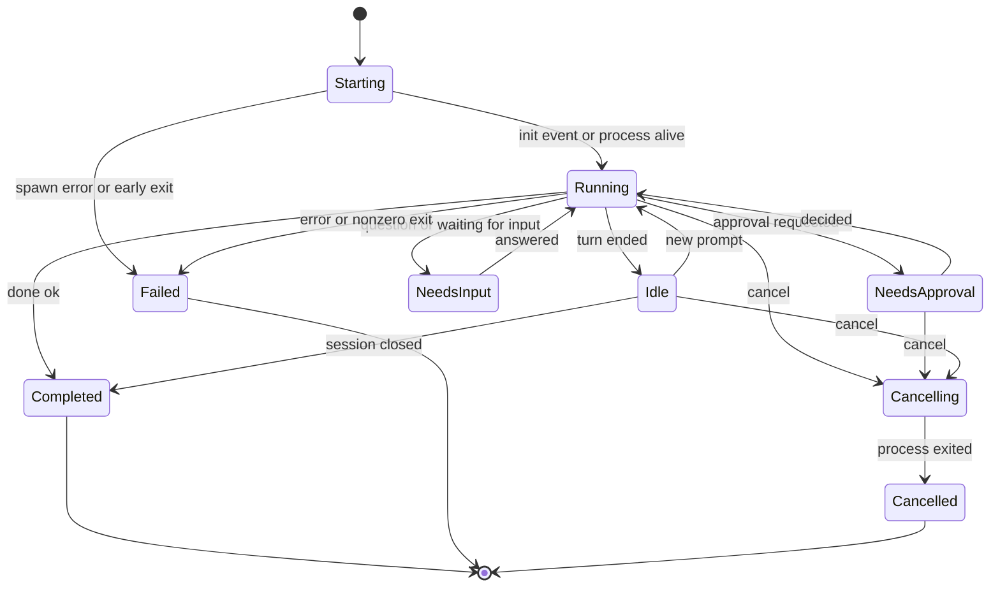

### 17.4 Launching a studio-started session

1. Allocate `session_id` (UUID v7) and `token` (32 random bytes, hex).
2. Write `sessions/<id>/settings.json` (mode 0600) registering `studio-hook` for `PreToolUse`, `PostToolUse`, `PostToolUseFailure`, `UserPromptSubmit`, `Stop`, `SubagentStart`, `SubagentStop`, `SessionStart`, `SessionEnd`, `Notification`, and (only for adapters without a permission-prompt tool) `PermissionRequest`.
3. Write `sessions/<id>/mcp.json` registering the `studio` MCP server (`studio-mcp`, stdio).
4. Build the environment from a scrubbed base (`PATH`, `HOME`, `USER`, `SHELL`, `LANG`, `TERM`) plus `STUDIO_SOCK`, `STUDIO_SESSION_ID`, `STUDIO_SESSION_TOKEN`, `STUDIO_PROJECT_ROOT`.
5. argv = `headless_cmd` or `interactive_cmd` + `session_id_args` + trust-profile args + `settings_args` + `mcp_args` (+ `permission_args` for headless). cwd = the space root.
6. Spawn through the supervisor as a new process group. Interactive sessions get a PTY; headless sessions get pipes.
7. Headless: write the first prompt to stdin as a stream-json user message.
8. A parser task reads stdout line by line → normalized events → `agent_events` (batched) and the event bus.

Per-session settings (the user's own `~/.claude` files are never modified):

```json
{
  "hooks": {
    "PreToolUse":  [{ "matcher": "*", "hooks": [{ "type": "command", "command": "'/Applications/Studio.app/Contents/MacOS/studio-hook' pre-tool-use", "timeout": 10 }] }],
    "PostToolUse": [{ "matcher": "*", "hooks": [{ "type": "command", "command": "'/Applications/Studio.app/Contents/MacOS/studio-hook' post-tool-use", "timeout": 10 }] }],
    "PostToolUseFailure": [{ "matcher": "*", "hooks": [{ "type": "command", "command": "'/Applications/Studio.app/Contents/MacOS/studio-hook' post-tool-use-failure", "timeout": 10 }] }],
    "UserPromptSubmit": [{ "hooks": [{ "type": "command", "command": "'/Applications/Studio.app/Contents/MacOS/studio-hook' user-prompt-submit", "timeout": 10 }] }],
    "Stop":         [{ "hooks": [{ "type": "command", "command": "'/Applications/Studio.app/Contents/MacOS/studio-hook' stop", "timeout": 10 }] }],
    "Notification": [{ "hooks": [{ "type": "command", "command": "'/Applications/Studio.app/Contents/MacOS/studio-hook' notification", "timeout": 10 }] }]
  }
}
```

### 17.5 Hook relay protocol (`studio-hook` ↔ core)

- `studio-hook <event>` reads the hook JSON from stdin, connects to `$STUDIO_SOCK`, and sends one frame: `u32 LE length` + JSON `{ "v": 1, "token": "...", "session_id": "...", "event": "pre-tool-use", "payload": { ...hook json... } }`.
- The core replies with `{ "stdout": <hook output JSON or null>, "exit": 0 }`. The helper prints `stdout` and exits with `exit`.
- Latency target: p50 < 15 ms, p99 < 80 ms, excluding approval waits.

| Event | Core-side handling | Output |
|---|---|---|
| PreToolUse | correlate `tool_use_id`; check the trust-profile denylist and claims; take the pre checkpoint | empty by default, so the CLI's own permission logic continues. `deny` or `ask` only when policy says so. **Never `allow`** from the attribution path, which would bypass the CLI's permission system |
| PostToolUse, PostToolUseFailure | post checkpoint; derive `FileEdit` events; update presence | empty |
| UserPromptSubmit / Stop | turn boundaries for the timeline | empty |
| SubagentStart / SubagentStop | nested spans | empty |
| Notification | if the session's terminal tab is not visible, raise `AgentWaiting` | empty |
| PermissionRequest | raise an `Approval` attention item and wait for Jay | `{"hookSpecificOutput":{"hookEventName":"PermissionRequest","decision":{"behavior":"allow"}}}` or `"deny"` with a message |

Output shapes were checked in the 2.1.314 bundle: PreToolUse `permissionDecision` ∈ {allow, deny, ask, defer}; PermissionRequest `decision.behavior` ∈ {allow, deny}.

**Failure modes (CL-03)**

| Event | Core unreachable or timed out | Why |
|---|---|---|
| PreToolUse, PostToolUse, Stop, UserPromptSubmit, Subagent\* | exit 0 with no output (fail open). When the core reconnects it marks the session `degraded` and lowers confidence for the gap | never block Jay's agent because the UI crashed |
| PermissionRequest, `approval_prompt` (studio-launched headless) | deny with "Studio is not reachable" (fail closed) | approvals must never pass silently |
| Notification | exit 0 | informational only |

### 17.6 Tasks and scheduling

```rust
pub struct Task {
    pub id: TaskId, pub project: ProjectId, pub title: String, pub prompt: String,
    pub context: Vec<ContextItem>,          // files, selection, error, diff, branch
    pub adapter: AdapterKey,
    pub isolation: Isolation,               // InPlace | Worktree | Scratch
    pub trust: TrustProfile,
    pub done_when: Vec<DoneCriterion>,      // e.g. RunConfigPasses("test")
    pub budget: Budget,                     // wall clock, optional USD cap if the CLI reports cost
    pub status: TaskStatus, pub session: Option<SessionId>, pub created_by: Actor,
}
pub enum TaskStatus { Queued, Preparing, Running, NeedsYou, Checking, ReviewReady, Applying, Done, Failed, Cancelled }
```

- **Queue:** priority (user-set), FIFO within a priority. Global concurrency `max_parallel_tasks` (default 3) through a semaphore, plus a per-project limit.
- **Admission:** create the space → baseline checkpoint → spawn.
- **Done criteria:** after the agent finishes, run the criteria in the task's space through the build service and attach ✓/✗ to the inbox item. Optional automatic follow-up ("tests failed: <summary>; fix them"), up to N times (P2).
- **Cancel:** SIGINT to the process group → 5 s → SIGTERM → 3 s → SIGKILL. The worktree is kept until Jay discards it, so partial work can still be reviewed.

### 17.7 Worktree manager

- Path `worktrees/<project-id>/<task-id>`, branch `studio/task/<task-id>`, created with `git worktree add -b studio/task/<id> <path> HEAD`.
- **Baseline materialization (CL-02):** copy Jay's uncommitted and untracked (not ignored) files from the current ledger snapshot into the worktree. Nothing is committed. Record the result as the worktree's baseline checkpoint.
- **Non-git projects:** use `scratch_copy`, created with APFS copy-on-write clones (`clonefile(2)`, as in `cp -c`). It is near-instant and shares disk blocks.
- **Cleanup:** when every hunk is decided, `git worktree remove --force` and delete the branch. Run `git worktree prune` on startup.

### 17.8 Review inbox

- Items are the **AI hunks** of `diff(baseline_tree, final_tree)` for the task's space, taken from the ledger (one attribution engine, ARCHITECTURE §8A.8).
- Hunk identity: `sha256(path ‖ base_blob_oid ‖ normalized_patch)`. Stable across re-renders.
- **Apply, per file:**
  1. `B` = baseline content, `W` = `B` with only the accepted hunks applied, `M` = current main-tree content.
  2. If `M == B`, write `W`. Otherwise run `git merge-file -p M B W` (ours = M, base = B, theirs = W).
  3. Clean merge → write. Conflict → open the conflict view; the hunks stay pending.
  4. Before any write: a safety checkpoint (actor Studio, cause `inbox_apply`). Writes go through `studio-fs` atomic writes. Inserted lines keep their AI origin, with `accepted_by = You`.
- **P0 guarantee:** the only code path that writes worktree content into the main tree is `inbox.apply` carrying explicit hunk IDs from a command whose actor is `Human`. A property test checks that no other command can do it.

### 17.9 Approval routing (H-04)

Sources: (1) headless Claude via `--permission-prompt-tool mcp__studio__approval_prompt`; (2) the `PermissionRequest` hook for adapters without a permission tool; (3) policy `Ask` decisions from PreToolUse; (4) ACP permission requests from future adapters.

```rust
pub struct ApprovalSpec {
    pub tool: String, pub input_preview: String, pub cwd: RelPath,
    pub risk: Risk,                 // Low | Medium | High
    pub reasons: Vec<String>,       // "installs packages", "network access"
    pub matched_rule: Option<RuleId>,
    pub suggestions: Vec<RuleSuggestion>, // e.g. allow "npm install --save-dev *" for this session
}
```

**Deterministic risk rules.** High: deletes outside the space, `sudo`, writes to dotfiles or credential stores, download-and-execute (`curl … | sh`), `git push`, force flags. Medium: package installs, network fetches, writes outside the task's usual directories. Low: read-only commands.

**Decisions:** AllowOnce, AllowSession(rule), AllowProject(rule) (stored in `policy_rules`, visible and revocable in Settings), Deny(note). High risk may require Touch ID (P2). Headless approvals wait indefinitely (the task shows **Needs you**). Interactive sessions keep the CLI's own prompts in the terminal; Studio raises `AgentWaiting` only when that terminal is not visible.

## 18. Agent Gateway (`studio-gateway`, H-02)

### 18.1 Transport

The agent CLI spawns `studio-mcp` once per session as a stdio MCP server. `studio-mcp` connects to the core socket, sends `{ "v": 1, "kind": "mcp", "token": "...", "session_id": "..." }`, then copies bytes in both directions. **All MCP logic runs in the core** (`rmcp` server over the socket stream), so policy has one enforcement point and the bridge stays around 150 lines with no dependencies beyond `std` and a JSON encoder.

### 18.2 Tool catalog (v1)

| Tool | Input | Output | Capability | Priority |
|---|---|---|---|---|
| `studio_workspace` | — | root, languages, run configs, LSP status, current task | read | P1 |
| `studio_diagnostics` | path?, min severity? | normalized problems (≤ 200, summarized beyond) | lsp.read | P1, needs T52 |
| `studio_symbols` | query, kind? | workspace symbols with locations | lsp.read | P1, needs T52 |
| `studio_definition`, `studio_references` | path, line, column | locations | lsp.read | P1, needs T52 |
| `studio_search` | pattern, glob?, max? | ripgrep matches | read | P1 |
| `studio_run` | run-config name | exit code, problems, test summary | build.run | P1, needs T54/T55 |
| `studio_test_results` | run id? | test tree summary and failures | read | P1 |
| `studio_changes` | since: session start / turn n / HEAD | this session's files and hunks | ledger.read | P1 |
| `studio_ask_human` | question, options[]?, timeout? | the answer | collab.ask | P1 (H-07) |
| `studio_task_update` | note, plan items | ack | task.write (own task only) | P1 (H-09) |
| `studio_request_review` | summary | ack (raises an attention item) | collab.ask | P1 |
| `studio_presence` | — | what Jay is editing (unsaved files) | collab.read, off by default | P2 (H-08) |
| `approval_prompt` | the CLI's permission-prompt payload | allow or deny (+ updated input) | internal | P1 (H-04) |

Resources (P2): `studio://task` (brief and done criteria), `studio://instructions` (project instruction files), `studio://map` (languages, top-level layout, run configs).

**Rules:** results are data, never instructions; paths are relative to the project root; secrets are redacted; each result is capped at 64 KB with a "truncated: N more" summary; at most 8 concurrent calls per session; every call is audited (tool, argument hash, decision, duration).

The `approval_prompt` contract follows the CLI's permission-prompt-tool schema (input: tool name, tool input, tool-use id; output: JSON text `{"behavior":"allow","updatedInput":{…}}` or `{"behavior":"deny","message":"…"}`). Confirm the exact schema during T32/T43.

### 18.3 Capability envelope by trust profile

| Capability | Observe | Propose | Pair | Autopilot |
|---|---|---|---|---|
| read, lsp.read, ledger.read | ✓ | ✓ | ✓ | ✓ |
| build.run | — | ✓ (own space) | ask | ✓ (own space) |
| collab.ask | ✓ | ✓ | ✓ | ✓ |
| task.write | own task | own task | own task | own task |
| collab.read (Jay's focus) | per-project setting | per-project setting | per-project setting | per-project setting |

## 19. Collaboration hub (`studio-collab`)

### 19.1 Presence (H-05)

```rust
pub struct Presence {
    pub actor: Actor, pub project: ProjectId, pub space: SpaceId,
    pub path: Option<RelPath>, pub range: Option<LineRange>,
    pub activity: Activity, pub since: Instant, pub ttl: Duration,
}
pub enum Activity { Viewing, Editing, Reading, Running(String), Searching(String), Thinking, Waiting }
```

Sources: UI focus events (Jay), agent `ToolCall` targets, the PTY foreground process. Coalesced per actor and broadcast at most every 250 ms. TTL 30 s for agents, 10 s after blur for Jay. Memory only.

### 19.2 Claims (H-08, P2)

```rust
pub struct Claim { pub id: ClaimId, pub actor: Actor, pub path: RelPath, pub range: Option<LineRange>,
                   pub reason: ClaimReason /* DirtyBuffer | AgentEditing | Manual */, pub expires_at: Instant }
```

- An unsaved buffer creates a `DirtyBuffer` claim automatically. An in-place agent edit holds an `AgentEditing` claim for 60 s after its last edit.
- When an agent in the **same space** tries to edit a path with Jay's `DirtyBuffer` claim, PreToolUse returns `ask` with "Jay has unsaved changes in this file" (Pair profile). Worktree tasks are in a different space, so they never conflict.
- Claims never block Jay. They drive the contested banner.

### 19.3 Attention queue (H-06)

```rust
pub struct AttentionItem {
    pub id: AttentionId, pub kind: AttentionKind, pub project: ProjectId,
    pub task: Option<TaskId>, pub session: Option<SessionId>, pub actor: Actor,
    pub priority: u8, pub created_at: Timestamp, pub state: AttentionState, // Open | Resolved | Expired
    pub payload: serde_json::Value, pub resolution: Option<serde_json::Value>,
}
pub enum AttentionKind { Approval, Question, ReviewReady, TaskFailed, Contested, BudgetExceeded, TrackingDegraded, AgentWaiting }
```

- Persisted, so it survives restarts. Approvals for sessions that have ended expire automatically.
- Ordering: items that block an agent (approvals, questions, waiting) → failures → contested files → reviews ready.
- Drives the toolbar badge, the Dock badge (open approvals + unreviewed AI hunks), the menu bar extra, and notifications. Notifications fire only when the app is inactive or the item is high priority (Focus filters are P2).

## 20. Change Ledger

### 20.1 Shadow repository

- Location: `shadow/<project-id>.git`, used only through explicit environment variables.
- Every shadow invocation clears inherited `GIT_*` variables, then sets `GIT_DIR=<shadow>`, `GIT_WORK_TREE=<space root>`, `GIT_INDEX_FILE=<shadow>/index-<space-id>`, `GIT_CONFIG_NOSYSTEM=1`, and `GIT_CONFIG_GLOBAL=/dev/null`, so Jay's global git config, hooks, and filters never affect snapshots.
- Shadow config: `core.autocrlf=false`, `core.filemode=true`, `core.symlinks=true`, `core.untrackedCache=true`, `core.fsmonitor=false`, `gc.auto=0`. `info/exclude` holds the studio ignore list. The work tree's own `.gitignore` files apply automatically, and git never adds a nested `.git` directory.
- **One persistent index per space** (main tree and each worktree), so incremental updates stay cheap. This is separate from Jay's `.git/index`, which is never touched.
- **Reachability:** each session keeps a commit chain at `refs/studio/sessions/<session-id>`. Every checkpoint is a commit (tree + parent + metadata message). This makes gc safe and lets a developer inspect checkpoints with plain git.

### 20.2 Snapshot algorithm

```
snapshot(space, cause, known_paths = none):
  dirty = known_paths ∪ watcher.drain_dirty(space)            # deduplicated
  if watcher.overflowed(space) or first snapshot of space: full scan (git add -A with shadow env)
  if dirty is empty: return last_tree(space)                    # no-op
  for p in dirty, skipping ignored paths:
      if p is missing:                    remove p from the shadow index
      elif size(p) > 50 MB (CL-01):       stage placeholder "studio-large:<sha256>:<size>", flag large
      else:                               hash-object -w p   (binary when a NUL appears in the first 8 KB)
  git update-index -z --index-info        # one batched process
  tree   = git write-tree                 # cache-tree keeps this proportional to changed directories
  commit = git commit-tree tree -p <prev> -m <metadata>
  git update-ref refs/studio/sessions/<sid> commit
  return tree
```

Cost is proportional to the dirty set plus changed directories. The full scan runs only for the first baseline of a space. Start with the git CLI (three short process spawns, roughly 5–10 ms each). If T30's benchmark misses 100 ms, move object and tree writes to `gix` in-process.

### 20.3 Checkpoint correlation

```
on Pre(call):
    gap = snapshot(space, cause = gap)
    if gap.tree != last_tree: record checkpoint(actor = attribute_gap(...))   # closes the human/external interval
    open_calls[call.id] = current checkpoint                                  # the pre marker
on Post(call):
    known = file targets of call                       # Edit/Write paths, so no FSEvents wait is needed
    if call is Bash or unknown: await quiescence(space, 120 ms, cap 600 ms)
    post = snapshot(space, cause = tool_call, known)
    record checkpoint(actor = AI(session, turn, tool, call), confidence = Certain if hooks/events else Likely)
    file_changes += diff(open_calls[call.id].tree, post.tree); update provenance of changed files
on fs.write(path) by Jay (studio editor or file tree):
    snapshot(space, cause = gap)                       # closes any open interval at this instant
    atomic write
    snapshot(space, cause = user_save, known = [path]) → actor You, Certain     (CL-04)
```

**Gap attribution** (changes between `post(n)` and `pre(n+1)`, or detected with no matching event):

| Situation | Actor | Confidence |
|---|---|---|
| written through `fs.write` (studio editor or tree) | You | Certain |
| written by a Studio formatter, git operation, or scaffold step | Studio(component) | Certain |
| a Studio terminal's foreground process is an editor or tool Jay started, and no agent call is open | You (terminal) | Likely (P2 refinement) |
| an agent process is running, no call is open, Studio did not write it (no hooks or events) | AI(session) | Likely |
| none of the above | External | Likely |

- If an **external** tool writes inside an open AI call window, the change is attributed to that call with confidence Likely, and the file is flagged.
- **Two in-place sessions in one space** (discouraged): calls correlate per session. Files touched in overlapping windows are marked `ambiguous` and listed for Jay to resolve (P2). Sessions in separate worktrees never interfere: separate spaces, separate indexes (acceptance scenario 10).

### 20.4 Line provenance

- **Origin = checkpoint id.** The checkpoint row already carries actor, session, turn, tool, and confidence, so no origins table is needed.
- `line_provenance.lines_blob` (varint-encoded) for each (path, version):
  - **runs** `(len, origin_cp, prev_origin_cp | 0)`. `prev_origin` is set when one actor modified a line another actor wrote ("AI, then edited by you").
  - **tombstones** `(position_in_new, count, removed_by_cp, original_origin_cp)`.
- **Update(old, new, cp):** diff old→new lines with `similar` (Patience), then: Equal → copy runs; Insert → `(n, cp, 0)`; Delete → tombstone; Replace → `(n, cp, old_origin)` when the old origin's actor differs from `cp`'s actor, else `(n, cp, old_prev)`.
- Whitespace-only and CRLF-only changes are recorded and labeled; whether they count is a user toggle.
- Computed only for text files up to 2 MB. Everything is rebuildable by replaying the session commit chains.

### 20.5 Views

- **Three layers:** L1 = `diff(HEAD_tree, baseline_tree)` (HEAD read with gix; empty for non-git projects), L2 = `diff(baseline_tree, now_tree)` with provenance, All = `diff(HEAD, now)`.
- **AI-only diff** from a start point S (session start, turn n, call k, HEAD, last reviewed): for each file, `diff(S_tree, now_tree)`; keep hunks whose inserted lines (by provenance) or deleted lines (by tombstone) belong to AI checkpoints of the selected sessions after S. Mixed hunks split into AI sub-hunks; other lines show as dimmed context or are hidden.
- **Caching:** diffs keyed by (old oid, new oid, options) in an LRU capped at 64 MB. Per-session file summaries (counts) are updated incrementally at each checkpoint.

### 20.6 Selective revert

Units: hunk, file, tool call, turn, session.

```
revert(unit):
  safety = snapshot(cause = pre_revert, actor = Studio)
  calls  = AI calls covered by unit, newest first
  for each file f touched by those calls:
      cur = now(f)
      for call in calls where f ∈ call.files:
          pre    = content(call.pre, f);  post = content(call.post, f)
          theirs = pre                            # for a hunk unit: post with only that hunk reversed
          cur, conflict = git merge-file -p (ours = cur, base = post, theirs = theirs)
          if conflict: stop on f, open the conflict view (ours, base, theirs), continue with other files
      atomic write of cur; reverted lines get their prior origins back
```

Property tests: reverting every AI call of a session in which Jay made no edits restores the baseline exactly; Jay's edits outside AI-touched regions are never changed; reverting a revert (through the safety checkpoint) restores the post state.

**Restore point:** take a safety snapshot, then write the checkpoint's contents. Files absent from the checkpoint move to the Trash, limited to the space root.

### 20.7 Retention and gc

Keep sessions newer than 30 days, and always the latest 50 per project. Expiring a session deletes its refs and rows. Run `git gc --prune=now --quiet` on the shadow repo during idle time, skipping it on battery and in Low Power Mode.

### 20.8 Invariants (each has tests)

| ID | Invariant |
|---|---|
| I1 | The user's `.git` directory is byte-identical before and after any tracking operation |
| I2 | For each AI call, `diff(pre, post)` is attributed to that call only |
| I3 | Lines changed only through `fs.write` are never attributed to an AI |
| I4 | No main-tree write carries worktree content without an `inbox.apply` from `Human` |
| I5 | Revert never changes lines whose current origin is You, except when Jay resolves a conflict |
| I6 | Ledger state can be rebuilt from shadow commit chains plus checkpoint rows |

## 21. Terminal service (`studio-pty`)

### 21.1 Read, batch, and flow control

```
reader thread:  loop { n = read(master, 64 KB buffer); send chunk on a bounded channel (cap 32) }  # blocks when full
batcher task:   accumulate; flush when (8 ms elapsed and data waiting) or buffer ≥ 64 KB; never later than 16 ms
  on flush:     ring.append(bytes); osc.scan(bytes) → events
                if attached and in_flight < HIGH: send frame; in_flight += len
                if attached and in_flight ≥ HIGH: stop pulling from the reader channel → reader blocks → child blocks
UI:             xterm.write(data, () => ack(len)); acks are batched every 16 ms into pty.ack(session, bytes)
core:           in_flight -= acked; resume when in_flight ≤ LOW
detached:       no credits; the batcher keeps draining into the ring buffer so children never block without a UI
```

`HIGH` = 2 MB and `LOW` = 512 KB to start, tuned by the T23/T24 benchmarks.

### 21.2 Scrollback and replay

- Byte ring buffer with a line index, capped at 50k lines or 8 MB.
- **Replay on attach:** send `ESC c` (full reset), then bytes from the oldest safe offset (a line start that is not inside an escape sequence; the scanner records parser state at line starts), then live frames.
- If the alternate screen is active (tracked through `ESC[?1049h/l`), replay from the last alternate-screen entry and send a resize to force the full-screen program to redraw.

### 21.3 Shell integration and foreground process

- A streaming OSC 133 / OSC 7 scanner handles sequences split across chunks and emits `pty.command { phase: prompt_start | command_start | command_end, exit_code?, cwd? }`. Commands that run longer than 10 s while the window is inactive produce a notification (P1).
- **Foreground detection:** on output activity (debounced 300 ms) and every 2 s while active, read `master.process_group_leader()` → pid → name via `proc_pidpath` (macOS) or `/proc/<pid>/comm` (Linux CI), and compare with adapters' `detect.process_names` to open or close tracking sessions.
- Shells launched by Studio export `STUDIO_SOCK` and `STUDIO_TERMINAL_ID`, which makes the H-10 opt-in hook work.
- Spawn policy: the profile's shell must be in `/etc/shells` or the configured allowlist; argv only; environment = scrubbed base + profile.

## 22. File, git, search, LSP, build, learn, plugins

**File service (`studio-fs`)**
- `ApprovedPath` is a newtype that only `policy.canonicalize()` can construct. Every fs API takes `ApprovedPath`.
- Atomic write: temp file in the same directory, write, `fsync`, `rename`, `fsync` the directory; keep the file mode. If the target changed since the editor's base hash, return `Conflict` (contested flow) unless `force`.
- Trash through `NSFileManager trashItemAtURL` in the native module (Linux CI uses a test trash directory).
- Watcher: `notify` (FSEvents, file-level events, 50 ms latency) with `notify-debouncer-full` for UI events. The ledger receives raw path events into dirty sets. Overflow triggers a rescan.
- Ignore rules from the `ignore` crate: `.gitignore`, global excludes, the studio ignore list.

**Git service (`studio-git`)**
- Reads with gix (status including untracked, log, blame, diff). Writes with the git CLI and a scrubbed environment: for operations on the user's repo, `GIT_DIR`, `GIT_WORK_TREE`, and `GIT_INDEX_FILE` are always unset so the shadow environment can never leak.
- Writes are serialized per repo by an actor. If `index.lock` exists because Jay is running git, retry with backoff and say so in the UI.

**Search (`studio-search`)**: `nucleo` over an in-memory path list (built from an `ignore` walk, kept fresh by the watcher); ripgrep sidecar with `--json`, streamed and batched to the UI every 30 ms or 200 matches; FTS5 for history, notes, and lessons.

**LSP (`studio-lsp`)**: registry entries `{ language, command, args, root_markers, init_options }`; one server per (language, root), spawned lazily on the first file; restart with backoff; `lsp-types` for messages; diagnostics cached per file and shared by the editor, Problems, and the Gateway.

**Build (`studio-build`)**: run configurations → process runner (tokio::process, or a PTY for interactive configs) streaming to a dedicated output channel; problem normalizers (machine-readable formats first); test tree; dev-server port detection. The listening ports here belong to Jay's dev servers, not to Studio, so G1 is unaffected.

**Learn (`studio-learn`)**: markdown + frontmatter loader (`pulldown-cmark`), exercise checks through the build service, `fsrs-rs` scheduling. Tutor sessions are agent sessions with the Observe profile plus a tutor instruction file.

**Plugins (`studio-plugins`, P2)**: JSON-RPC over stdio, manifest capabilities checked by policy, crash isolation with backoff.

## 23. Policy service (`studio-policy`)

```rust
pub enum Subject { Human, Agent { session: SessionId, profile: TrustProfile }, Plugin(PluginId), Studio(Component) }
pub enum Action {
    FsRead(ApprovedPath), FsWrite(ApprovedPath), FsDelete(ApprovedPath),
    Spawn(SpawnSpec), AgentTool { tool: String, input: serde_json::Value },
    Gateway(Capability), Net,
}
pub enum Decision { Allow, Deny { reason: DenyReason }, Ask { spec: ApprovalSpec } }
pub trait Policy: Send + Sync {
    fn canonicalize(&self, project: ProjectId, input: &Path) -> Result<ApprovedPath, PathError>;
    fn check(&self, subject: &Subject, action: &Action, ctx: &Ctx) -> Decision; // every call is audited
}
```

**Evaluation order:** hard denies (`Net` for Studio itself, paths outside roots, denylisted commands) → trust-profile rules → session and project rules from earlier approvals → the subject's default.

**Canonicalization**
```
canonicalize(input, root):
  if input is relative: join with the project root
  reject NUL bytes and empty components
  realpath() the longest existing prefix (resolves symlinks)
  append the remaining components lexically; reject ".." in the remainder
  if the final path exists and is a symlink: resolve it and check again
  require the result to start with realpath(root) on a component boundary
  return ApprovedPath(result, root_id)
```
- APFS is case-insensitive and normalization-insensitive by default. Comparisons use the canonical form returned by `realpath`, and the tests cover `Foo`/`foo` and NFC/NFD names.
- **TOCTOU:** for writes, open the checked parent directory and operate relative to it with `O_NOFOLLOW` on the final component. The atomic write already creates its temp file and renames within that parent.

**Spawn allowlist:** registered adapters' executables (resolved absolute paths), LSP registry commands, run configurations Jay created, git, rg, and shells. Anything else becomes `Ask` for Jay or `Deny` for agents and plugins.

**Audit log (CL-05):** append-only table; triggers reject UPDATE and DELETE; each row stores `prev_hash` and `hash = sha256(prev_hash ‖ canonical_json(row))`. `policy.audit.verify` re-walks the chain. Rotation archives to a file with `VACUUM INTO` and starts a new chain whose genesis records the archived head hash.

## 24. Data model (DDL)

All tables also carry `created_at` and `updated_at` (Unix ms) where ARCHITECTURE §13 requires them; they are omitted below where they add nothing.

```sql
PRAGMA journal_mode = WAL;
PRAGMA foreign_keys = ON;

CREATE TABLE projects (
  id INTEGER PRIMARY KEY, path TEXT NOT NULL UNIQUE, bookmark BLOB, name TEXT NOT NULL,
  settings_json TEXT NOT NULL DEFAULT '{}', created_at INTEGER NOT NULL, updated_at INTEGER NOT NULL);

CREATE TABLE run_configs (
  id INTEGER PRIMARY KEY, project_id INTEGER NOT NULL REFERENCES projects(id) ON DELETE CASCADE,
  type TEXT NOT NULL, name TEXT NOT NULL, argv_json TEXT NOT NULL, env_json TEXT NOT NULL DEFAULT '{}',
  cwd TEXT, before_launch_json TEXT NOT NULL DEFAULT '[]', created_at INTEGER NOT NULL, updated_at INTEGER NOT NULL,
  UNIQUE (project_id, name));

CREATE TABLE terminal_profiles (
  id INTEGER PRIMARY KEY, name TEXT NOT NULL UNIQUE, shell TEXT NOT NULL, env_json TEXT NOT NULL DEFAULT '{}',
  cwd TEXT, startup_argv_json TEXT, created_at INTEGER NOT NULL, updated_at INTEGER NOT NULL);

CREATE TABLE agent_adapters (
  id INTEGER PRIMARY KEY, key TEXT NOT NULL UNIQUE, config_toml TEXT NOT NULL,
  detected_version TEXT, created_at INTEGER NOT NULL, updated_at INTEGER NOT NULL);

CREATE TABLE agent_tasks (
  id INTEGER PRIMARY KEY, project_id INTEGER NOT NULL REFERENCES projects(id) ON DELETE CASCADE,
  title TEXT NOT NULL, adapter TEXT NOT NULL, prompt TEXT NOT NULL, context_json TEXT NOT NULL DEFAULT '[]',
  isolation TEXT NOT NULL CHECK (isolation IN ('in_place','worktree','scratch_copy')),
  trust_profile TEXT NOT NULL DEFAULT 'propose' CHECK (trust_profile IN ('observe','propose','pair','autopilot')),
  done_when_json TEXT NOT NULL DEFAULT '[]', budget_json TEXT NOT NULL DEFAULT '{}',
  worktree_path TEXT, base_checkpoint_id INTEGER, status TEXT NOT NULL, session_ref TEXT,
  created_by TEXT NOT NULL DEFAULT 'human', started_at INTEGER, finished_at INTEGER,
  created_at INTEGER NOT NULL, updated_at INTEGER NOT NULL);
CREATE INDEX agent_tasks_by_status ON agent_tasks (project_id, status);

CREATE TABLE agent_sessions (
  id INTEGER PRIMARY KEY, uuid TEXT NOT NULL UNIQUE,
  project_id INTEGER NOT NULL REFERENCES projects(id) ON DELETE CASCADE,
  task_id INTEGER REFERENCES agent_tasks(id), adapter TEXT NOT NULL, terminal_id TEXT,
  mode TEXT NOT NULL CHECK (mode IN ('interactive','headless','tracking')),
  space TEXT NOT NULL, trust_profile TEXT NOT NULL, baseline_checkpoint_id INTEGER, session_ref TEXT,
  detection TEXT NOT NULL CHECK (detection IN ('launched','auto_detected','manual')),
  state TEXT NOT NULL, degraded INTEGER NOT NULL DEFAULT 0,
  started_at INTEGER NOT NULL, ended_at INTEGER, created_at INTEGER NOT NULL, updated_at INTEGER NOT NULL);

CREATE TABLE agent_events (                                  -- CL-07: keyed by session
  id INTEGER PRIMARY KEY, session_id INTEGER NOT NULL REFERENCES agent_sessions(id) ON DELETE CASCADE,
  seq INTEGER NOT NULL, turn INTEGER, kind TEXT NOT NULL, payload_json TEXT NOT NULL, ts INTEGER NOT NULL,
  UNIQUE (session_id, seq));
CREATE VIRTUAL TABLE agent_events_fts USING fts5(           -- rowid = agent_events.id
  text, content = '', contentless_delete = 1, tokenize = 'porter unicode61');

CREATE TABLE checkpoints (
  id INTEGER PRIMARY KEY, project_id INTEGER NOT NULL REFERENCES projects(id) ON DELETE CASCADE,
  space TEXT NOT NULL, session_id INTEGER REFERENCES agent_sessions(id), seq INTEGER NOT NULL, ts INTEGER NOT NULL,
  actor TEXT NOT NULL CHECK (actor IN ('baseline','pre','ai','you','studio','external')),
  cause TEXT NOT NULL, turn INTEGER, tool_call_id TEXT, tool_name TEXT,
  tree_oid TEXT NOT NULL, commit_oid TEXT NOT NULL, parent_id INTEGER REFERENCES checkpoints(id),
  confidence TEXT NOT NULL CHECK (confidence IN ('certain','likely','ambiguous')),
  UNIQUE (project_id, space, seq));
CREATE INDEX checkpoints_by_session ON checkpoints (session_id, seq);

CREATE TABLE file_changes (
  id INTEGER PRIMARY KEY, checkpoint_id INTEGER NOT NULL REFERENCES checkpoints(id) ON DELETE CASCADE,
  path TEXT NOT NULL,
  change_type TEXT NOT NULL CHECK (change_type IN ('add','modify','delete','rename','mode','binary','large')),
  old_oid TEXT, new_oid TEXT, old_path TEXT, added INTEGER NOT NULL DEFAULT 0, removed INTEGER NOT NULL DEFAULT 0,
  generated INTEGER NOT NULL DEFAULT 0, tool_detail TEXT);
CREATE INDEX file_changes_by_path ON file_changes (path, checkpoint_id);

CREATE TABLE line_provenance (
  project_id INTEGER NOT NULL, space TEXT NOT NULL, path TEXT NOT NULL, version_oid TEXT NOT NULL,
  lines_blob BLOB NOT NULL, PRIMARY KEY (project_id, space, path, version_oid)) WITHOUT ROWID;

CREATE TABLE hunk_review (
  session_id INTEGER NOT NULL, path TEXT NOT NULL, hunk_hash TEXT NOT NULL,
  state TEXT NOT NULL CHECK (state IN ('unreviewed','reviewed')), ts INTEGER NOT NULL,
  PRIMARY KEY (session_id, path, hunk_hash)) WITHOUT ROWID;

CREATE TABLE review_items (
  id INTEGER PRIMARY KEY, task_id INTEGER NOT NULL REFERENCES agent_tasks(id) ON DELETE CASCADE,
  file TEXT NOT NULL, hunks_json TEXT NOT NULL,          -- [{hash, decision: pending|accepted|rejected, conflict}]
  state TEXT NOT NULL CHECK (state IN ('pending','partial','applied','discarded','conflict')),
  created_at INTEGER NOT NULL, updated_at INTEGER NOT NULL, UNIQUE (task_id, file));

CREATE TABLE attention_items (                               -- H-06
  id INTEGER PRIMARY KEY, project_id INTEGER NOT NULL REFERENCES projects(id) ON DELETE CASCADE,
  kind TEXT NOT NULL, priority INTEGER NOT NULL, task_id INTEGER, session_id INTEGER, actor TEXT NOT NULL,
  state TEXT NOT NULL CHECK (state IN ('open','resolved','expired')),
  payload_json TEXT NOT NULL, resolution_json TEXT, created_at INTEGER NOT NULL, resolved_at INTEGER);
CREATE INDEX attention_open ON attention_items (state, priority DESC, created_at);

CREATE TABLE policy_rules (                                  -- remembered approvals
  id INTEGER PRIMARY KEY, project_id INTEGER, session_id INTEGER,
  scope TEXT NOT NULL CHECK (scope IN ('session','project','global')),
  subject TEXT NOT NULL, action TEXT NOT NULL, pattern TEXT NOT NULL,
  effect TEXT NOT NULL CHECK (effect IN ('allow','deny','ask')),
  created_by TEXT NOT NULL, created_at INTEGER NOT NULL, expires_at INTEGER);

CREATE TABLE audit_log (                                     -- CL-05: append-only, hash-chained
  id INTEGER PRIMARY KEY, ts INTEGER NOT NULL, actor TEXT NOT NULL, task_id INTEGER, session_id INTEGER,
  action TEXT NOT NULL, target TEXT, decision TEXT, detail_json TEXT NOT NULL,
  prev_hash BLOB NOT NULL, hash BLOB NOT NULL);
CREATE TRIGGER audit_no_update BEFORE UPDATE ON audit_log BEGIN SELECT RAISE(ABORT, 'audit_log is append-only'); END;
CREATE TRIGGER audit_no_delete BEFORE DELETE ON audit_log BEGIN SELECT RAISE(ABORT, 'audit_log is append-only'); END;

CREATE TABLE notes (id INTEGER PRIMARY KEY, project_id INTEGER, title TEXT NOT NULL, body_md TEXT NOT NULL,
  created_at INTEGER NOT NULL, updated_at INTEGER NOT NULL);
CREATE VIRTUAL TABLE notes_fts USING fts5(title, body_md, content = 'notes', content_rowid = 'id');
CREATE TABLE snippets (id INTEGER PRIMARY KEY, language TEXT, title TEXT NOT NULL, body TEXT NOT NULL,
  created_at INTEGER NOT NULL, updated_at INTEGER NOT NULL);

CREATE TABLE learn_paths  (id INTEGER PRIMARY KEY, slug TEXT NOT NULL UNIQUE, title TEXT NOT NULL, source_path TEXT NOT NULL);
CREATE TABLE learn_topics (id INTEGER PRIMARY KEY, path_id INTEGER NOT NULL REFERENCES learn_paths(id) ON DELETE CASCADE,
  slug TEXT NOT NULL, ord INTEGER NOT NULL, title TEXT NOT NULL, UNIQUE (path_id, slug));
CREATE TABLE learn_attempts (id INTEGER PRIMARY KEY, exercise_id TEXT NOT NULL, passed INTEGER NOT NULL,
  output_ref TEXT, ts INTEGER NOT NULL);
CREATE TABLE cards (id INTEGER PRIMARY KEY, front TEXT NOT NULL, back TEXT NOT NULL, source_ref TEXT,
  created_at INTEGER NOT NULL, updated_at INTEGER NOT NULL);
CREATE TABLE card_reviews (id INTEGER PRIMARY KEY, card_id INTEGER NOT NULL REFERENCES cards(id) ON DELETE CASCADE,
  rating INTEGER NOT NULL, due INTEGER NOT NULL, stability REAL NOT NULL, difficulty REAL NOT NULL, ts INTEGER NOT NULL);
CREATE TABLE prefs (key TEXT PRIMARY KEY, value_json TEXT NOT NULL) WITHOUT ROWID;
```

Rules (ARCHITECTURE §13): WAL, forward-only versioned migrations (`rusqlite_migration` or `refinery`), one writer, and one-click export through the backup API or `VACUUM INTO` plus the learning-content folder.

## 25. UI client architecture

```
app/ui/src/
  core/          protocol client (generated types + call/subscribe/attach), event router, stream consumers
  stores/        Svelte 5 rune stores per domain: projects, buffers, terminals, agents, tasks, ledger,
                 inbox, attention, presence, settings
  commands/      registry: id, title, default keys, when-clause, handler. Feeds native menus, the palette,
                 Search Everywhere actions, and keymaps from one source
  shell/         dockview layout, tool-window bars, toolbar, status bar, layout persistence per project
  theme/         design tokens (Design 3), light/dark/increased contrast, motion
  editor/ terminal/ project-view/ ai-changes/ review-inbox/ mission-control/ attention/ agents/
  search/ git/ run/ problems/ learning/ settings/
```

- **Protocol client:** `call(name, args)` is typed by the generated `CommandMap`; `AbortSignal` maps to `op.cancel`; subscriptions filter by topic; a `Lagged` signal triggers a snapshot resync.
- **Hot paths bypass stores:** terminal frames go straight to xterm.js; agent event streams go to virtualized lists; presence updates are coalesced to animation frames.
- **CodeMirror extensions:** provenance gutter (a state field fed by `ledger.provenance` for the open version), presence cursors (decorations), contested banner (panel), LSP features.
- **Testing:** Vitest for units; Playwright against the Vite dev server with a **mock core** generated from protocol types plus fixtures (Tauri's WebDriver does not support macOS, so browser tests carry the UI suite); visual snapshots of key screens.

## 26. Errors, logging, diagnostics

- **Error classes:** user-actionable (`PolicyDenied`, `NotFound`, `Conflict`) shown inline with a next step; transient (`Busy`, `Unavailable`) retried with backoff; bugs (`Internal`) logged with a correlation id and shown as a short message with "Copy diagnostics".
- **Logging:** `tracing` with JSON lines in `~/Library/Logs/Studio/studio.log` (10 MB × 5 rotation) behind a redaction layer (Keychain values, token patterns, environment variables named `*TOKEN*`, `*KEY*`, `*SECRET*`).
- **Diagnostics panel:** supervisor states, queue depths, flow-control statistics, checkpoint timings, LSP status. No telemetry. "Export diagnostics" writes a local zip Jay can inspect before sharing.

## 27. Testing strategy

| Layer | Kind | Tools | Examples |
|---|---|---|---|
| protocol | round-trip, codegen drift | serde, specta | every command and event round-trips; regenerated TS equals the committed file |
| policy | adversarial, property | proptest | `..`, symlink escapes, case and Unicode-normalization variants, long paths |
| pty | integration, benchmark | criterion, flood generators | 50 MB/s; replay correctness; kill leaves no orphans |
| ledger | property + scenario | proptest, T33 fixtures | invariants I1–I6; acceptance scenarios 1–10 |
| agents | golden contract | recorded stream-json per CLI version | every fixture maps; unknown types tolerated |
| gateway | integration | fake MCP client over UDS | token auth, capability denials, payload caps, fail-closed approvals |
| inbox | integration | git fixtures | accept/reject next to Jay's dirty edits; conflicts |
| UI | component, e2e, visual | Vitest, Playwright + mock core | AI-only toggle; keyboard review flow |
| macOS | scripted manual checks, XCUITest where useful | — | bookmarks across relaunch; notification actions |
| performance | budgets in CI | custom harness | the §11 table |

## 28. Traceability

| Goal | Main components | Tasks and tests |
|---|---|---|
| G1 local only | no TCP, UDS, cargo-deny network/telemetry bans | T03, T84 port scan |
| G2 safety | policy, trust profiles, worktrees, inbox | T04, T34, T38, T42 |
| G3 durable sessions | core-owned sessions, replay | T20, T24, scenario 6 |
| G7 throughput | batching, credits | T20, T23, T24 |
| G16 attribution | Change Ledger | T30, T31, T33, T35, T36 |
| G17 agents as users (proposed) | Gateway, collaboration hub, Mission Control | T43–T46, T59 (Design 2 §7.4) |
